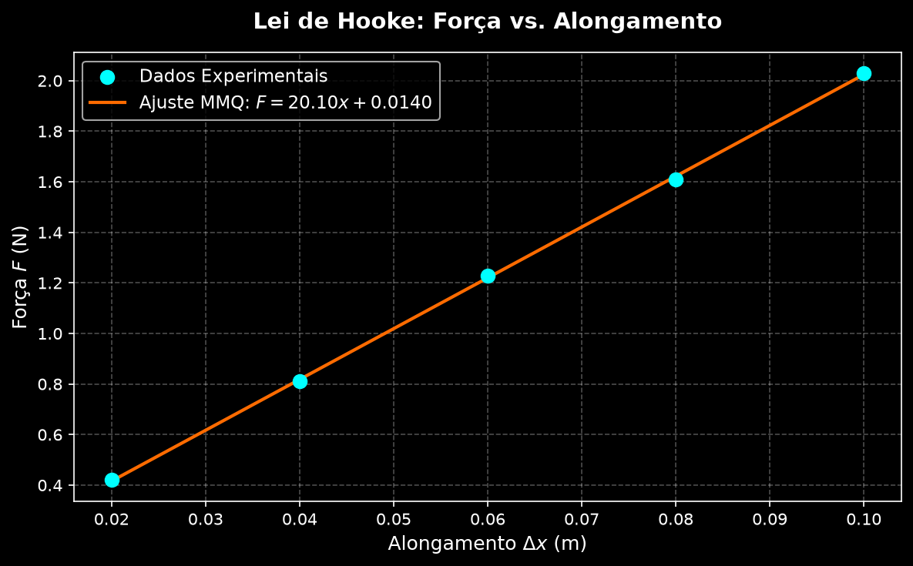

# 🎯 Lei de Hooke - Determinação Experimental da Constante Elástica

[](https://www.python.org/)
[](LICENSE)
[]()

Este repositório contém a análise experimental, o tratamento de dados e a regressão linear pelo Método dos Mínimos Quadrados (MMQ) para a verificação da **Lei de Hooke** ($F = k \cdot \Delta x$) com dados coletados em laboratório de Física Experimental.

---

## 📌 Objetivos

1. Verificar experimentalmente a relação de proporcionalidade direta entre a força aplicada $F$ e o alongamento $\Delta x$ de uma mola helicoidal.
2. Aplicar o **Método dos Mínimos Quadrados (MMQ)** para ajustar a reta de tendência aos pontos experimentais.
3. Determinar a **constante elástica $k$** da mola e o intercepto $b$.

---

## 📐 Fundamentação Teórica

A **Lei de Hooke** estabelece que, dentro do limite elástico do material, a força restauradora exercida por uma mola é diretamente proporcional à sua deformação:

$$F = k \cdot \Delta x$$

Onde:
- $F$ é a força aplicada ($\text{N}$).
- $k$ é a constante elástica da mola ($\text{N/m}$).
- $\Delta x = x - x_0$ é o alongamento da mola ($\text{m}$).

### Regressão Linear por Mínimos Quadrados (MMQ)

Para modelar a relação experimental $F(x) = k \cdot x + b$, minimiza-se o somatório do quadrado dos resíduos:

$$S = \sum_{i=1}^{n} (F_i - (k x_i + b))^2$$

A constante elástica $k$ (inclinação da reta) e o intercepto $b$ são calculados por:

$$k = \frac{n \sum (x_i F_i) - \sum x_i \sum F_i}{n \sum (x_i^2) - (\sum x_i)^2}$$

$$b = \frac{\sum F_i - k \sum x_i}{n}$$

---

## 📊 Dados Experimentais Coletados

| Ponto | Alongamento $\Delta x$ ($\text{m}$) | Força $F$ ($\text{N}$) |
| :---: | :---: | :---: |
| 1 | 0,020 | 0,42 |
| 2 | 0,040 | 0,81 |
| 3 | 0,060 | 1,23 |
| 4 | 0,080 | 1,61 |
| 5 | 0,100 | 2,03 |

---

## 📈 Resultados da Regressão Linear

Após o processamento dos dados via script Python (`src/lei_hooke_regressao.py`), foram obtidos os seguintes parâmetros:

- **Constante Elástica da Mola ($k$):** $20,10 \text{ N/m}$
- **Intercepto da Reta ($b$):** $0,0140 \text{ N}$
- **Equação Ajustada:** $F(x) = 20,10 \cdot x + 0,0140$

### 🖼️ Gráfico de Força vs. Alongamento



---

## 🗂️ Estrutura do Repositório

```text
lei-de-hooke-laboratorio/
├── README.md                      # Documentação principal do repositório
├── requirements.txt               # Lista de dependências em Python
├── .gitignore                     # Arquivos ignorados pelo Git
├── data/
│   ├── dados_hooke.json           # Medições experimentais em formato JSON
│   └── dados_hooke.csv            # Medições experimentais em formato CSV
├── src/
│   └── lei_hooke_regressao.py     # Script Python para MMQ e geração do gráfico
└── assets/
    └── grafico_lei_hooke.png      # Imagem do gráfico ajustado
```

---

## 💻 Como Executar o Projeto

### Pré-requisitos
- Python 3.10 ou superior.

### 1. Clonar o repositório e acessar a pasta
```bash
git clone https://github.com/jAk7star/lei-de-hooke-laboratorio.git
cd lei-de-hooke-laboratorio
```

### 2. Instalar as dependências
```bash
pip install -r requirements.txt
```

### 3. Executar o script de regressão linear
```bash
python src/lei_hooke_regressao.py
```

---

## 📜 Licença
Este projeto é disponibilizado sob a licença MIT. Consulte o arquivo [LICENSE](LICENSE) para mais detalhes.
